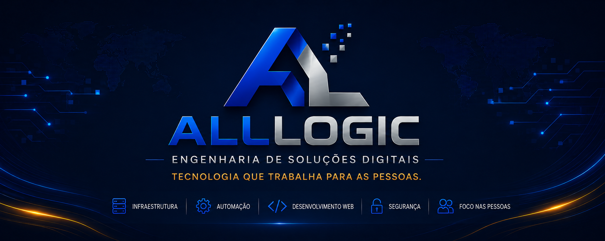

  

# Bem-vindo à AllLogic Online

> Tecnologia que trabalha para as pessoas.

---

## Quem é a AllLogic Online

A AllLogic Online é uma empresa de engenharia de soluções digitais. Seu propósito é desenvolver soluções que unam arquitetura, engenharia e documentação para atender necessidades reais com clareza, responsabilidade e qualidade.

A AllLogic Online desenvolve seus projetos com foco em arquitetura, documentação, qualidade técnica e evolução contínua. Cada iniciativa busca produzir soluções compreensíveis, rastreáveis e sustentáveis ao longo do tempo.

---

## Como trabalhamos

A AllLogic Online adota princípios que orientam a construção e a evolução de suas soluções:

- Arquitetura antes da implementação.
- Documentação integrada ao desenvolvimento.
- Adoção consciente de tecnologias.
- Separação clara de responsabilidades.
- Validação antes da publicação.
- Melhoria contínua.

---

## Soluções Comerciais — Família Agillex

- **[Agillex Hub](https://alllogiconline.com.br/agillex-hub/):** Plataforma Unificada de Gestão Operacional, Atendimento WhatsApp Oficial com IA, Agendamento Online Sincronizado, Funil CRM Kanban e Cobrança Integrada com Taxa Fixa de R$ 1,99.
- **[Agillex Agenda](https://alllogiconline.com.br/agillex-agenda/):** Sistema de Agendamento Online Sincronizado com Google Calendar, página pública exclusiva 24/7 e lembretes automáticos via WhatsApp (redução comprovada de até 85% em faltas).
- **[Agillex Atendimento](https://alllogiconline.com.br/agillex-atendimento/):** Agente de Inteligência Artificial humanizada 24/7 no WhatsApp Oficial com base de conhecimento (RAG) e transbordo humano em 1 clique.

---

## Projetos Estratégicos

### Projeto Atlas

Site institucional da AllLogic Online (https://alllogiconline.com.br), desenvolvido para apresentar a empresa, seus serviços, sua visão de engenharia e sua forma de desenvolver soluções digitais.

### Manual Operacional da AllLogic Online (MOA)

Conjunto de padrões e procedimentos que orientam o desenvolvimento, a homologação tecnológica e a evolução das iniciativas da empresa.

### Infraestrutura AllLogic Online

Base de ambientes, publicação e serviços que sustenta os projetos digitais da AllLogic Online com segurança, organização e continuidade operacional.

---

## Áreas de Atuação

- Engenharia de Soluções Digitais
- Arquitetura de Soluções
- Plataformas SaaS e Produtos Digitais
- Inteligência Artificial Aplicada & Atendimento Humanizado
- Desenvolvimento Web
- Infraestrutura e Publicação de Aplicações
- Automação de Processos
- Documentação Técnica

---

## Tecnologias

- Astro
- Next.js & React
- TypeScript
- CSS & TailwindCSS
- PostgreSQL & Redis
- Docker
- Traefik
- Cloudflare
- Git

---

## Sobre o Fundador

A AllLogic Online foi fundada por **Lucas Dresler**, que conduz a evolução da empresa com foco em arquitetura, infraestrutura, automação e documentação técnica.

---

## Contato

- GitHub: https://github.com/lucasdresler
- LinkedIn: https://linkedin.com/in/lucasdresler
- Site institucional: https://alllogiconline.com.br

---

<strong>AllLogic Online</strong> 
Engenharia de Soluções Digitais
  
Tecnologia que trabalha para as pessoas.

